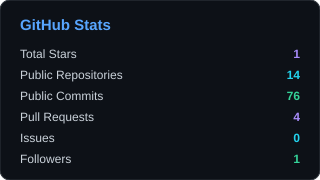
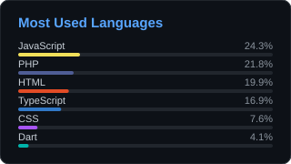
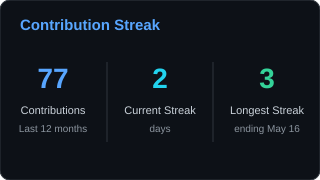

  

## About Me

Hello, I'm **Md. Sahriar Hossain**. While AI can generate code, I focus on the human side of engineering: solving complex problems, designing smart architecture and building intelligent systems.

<table width="100%">
  <tr>
    <td width="25%" valign="top">🎓 <b>Education</b> CSE Graduate United International University (UIU)</td>
    <td width="25%" valign="top">💼 <b>Experience</b> Full Stack Intern Softeins Lab · Architecture &amp; Backend</td>
    <td width="25%" valign="top">🤖 <b>Aspiring</b> AI/ML Engineer Data-driven logic &amp; models</td>
    <td width="25%" valign="top">💡 <b>Core Focus</b> AI/ML · Scalable Architecture Problem Solving</td>
  </tr>
</table>

## Technologies

**👨‍💻 Programming and Markup Languages**

       

**🧰 Frameworks and Libraries**

      

**🗄️ Databases**

   

**💻 Software and Tools**

    

## GitHub Statistics

Generated from public GitHub data by <code>scripts/generate.mjs</code> and refreshed every 6 hours. Counts cover public activity only.

## Contribution Graph

Contributions by year 
   

## Featured Projects

<!-- PROJECTS:START -->

### Israt Caregiver SaaS

Healthcare SaaS platform for managing caregiving services.

`Next.js` `React` `NestJS` `TypeScript`

 

### [UIU Social Connect](https://github.com/oyon79/UIU-Social-Connect)

Social networking platform for UIU students with a feed, messaging and community features.

`Node.js` `Express` `Socket.IO` `MySQL`

 

### SafetyNet

Personal safety-focused mobile application. 🏆 **1st Runner-Up**, UIU AOOP Project Show, Fall 2025.

`React Native` `Spring Boot`

 

### [Krishoker Ponno](https://github.com/oyon79/Krishoker_Ponno)

Agriculture-focused platform connecting farmers with the market.

`Flutter` `Supabase`

<!-- PROJECTS:END -->

## Experience &amp; Achievements

|     | Role / Award                                    | Where        |
| --- | ----------------------------------------------- | ------------ |
| 💼  | **Full Stack Development Intern**               | Softeins Lab |
| 🏆  | **1st Runner-Up**, AOOP Project Show, Fall 2025 | UIU          |
| 🛡️  | **SafetyNet**, recognized project (see above)   | UIU          |

<a href="https://www.linkedin.com/in/md-sahriar-hossain-671545255/"><b>Let's connect</b></a> · <a href="mailto:mdsahriar2620@gmail.com"><b>Say hello</b></a>

